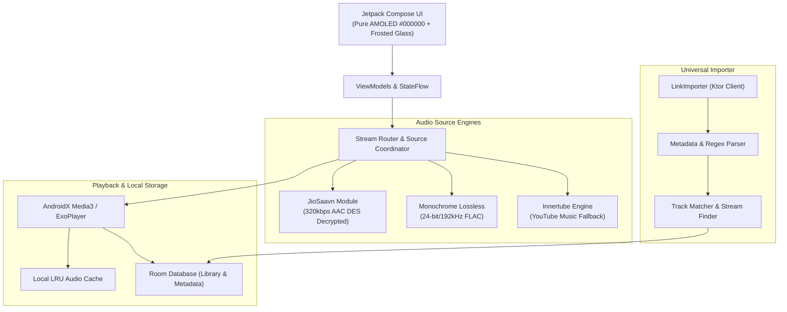

<div align="center">

  

  <br/>

  # ⚡ Aura Music (Mochy Core)
  ### The Ultimate Open-Source Hybrid Music Engine for Android

  <p align="center">
    <b>Spotify UI • Apple Music 24-bit Lossless • JioSaavn 320kbps Bollywood & Regional • 1-Click Universal Importer</b>
  </p>

  <p align="center">
    <sub>Zero Ads • Zero Trackers • No Account Required • 100% Free & Open-Source</sub>
  </p>

  <p align="center">
    <a href="https://github.com/satyasanatan989/aura-music/releases/latest">
      
    </a>
    <a href="https://github.com/satyasanatan989/aura-music/stargazers">
      
    </a>
    <a href="https://github.com/satyasanatan989/aura-music/network/members">
      
    </a>
    <a href="https://github.com/satyasanatan989/aura-music/blob/main/LICENSE">
      
    </a>
    <a href="https://discord.gg/4DAafDMxZb">
      
    </a>
  </p>

</div>

---

## 🌟 Why Aura?

Why pay **$120+/year** for three separate music subscriptions when you can experience all of them unified in one lightning-fast, privacy-first Android client?

Aura combines the best of all worlds:
- 🟢 **Spotify’s** fluid discovery, playlist curation, and synchronized lyrics.
- 🍎 **Apple Music’s** pristine **24-bit/192kHz Hi-Res Lossless** (ALAC/FLAC) audio & spatial depth.
- 🇮🇳 **JioSaavn’s** massive catalog of Bollywood, Hindi, Punjabi, and Indian regional music with direct **320kbps AAC** streaming.
- 🪄 **Mochy’s Universal Importer**: Paste any Spotify, Apple Music, or YouTube Music link to import playlists instantly.

---

## 📊 Feature Comparison Matrix

| Feature | Spotify Premium | Apple Music | JioSaavn Pro | **Aura Music (Mochy)** |
| :--- | :---: | :---: | :---: | :---: |
| **Subscription Cost** | $11.99 / mo | $10.99 / mo | $4.99 / mo | **$0.00 (100% Free FOSS)** |
| **Audio Quality** | 320 kbps Ogg | 24-bit/192kHz ALAC | 320 kbps AAC | **24-bit/192kHz FLAC + 320k AAC** |
| **Bollywood & Indian Catalog** | Partial | Partial | Full | **Complete (Zero Geo-Blocks)** |
| **Universal Playlist Importer** | ❌ (Locked-in) | ❌ (Locked-in) | ❌ (Locked-in) | **✅ 1-Click Import (Any Link)** |
| **Account Required** | Mandatory | Mandatory | Mandatory | **❌ Zero Account Needed** |
| **Ad-Free Offline Downloads** | Paid Only | Paid Only | Paid Only | **✅ Bit-Perfect Local Caching** |
| **Synchronized Lyrics** | Standard | Standard | Basic | **✅ Real-Time Glowing Lyrics** |
| **Retro iPod Mode** | ❌ | ❌ | ❌ | **✅ Built-in Clickwheel Player** |
| **Audio Equalizer** | Basic 5-Band | Presets Only | Basic | **✅ Pro 10-Band + Spatial DSP** |
| **Privacy & Telemetry** | High Tracking | Moderate | High Tracking | **🛡️ 100% No Analytics / FOSS** |

---

## ✨ Key Features

### 🚀 1. Hybrid Multi-Source Audio Engine
Never suffer missing songs or geo-restrictions again. Aura’s smart routing engine matches and resolves tracks in real-time:
* **Monochrome Lossless**: Ultra-high-fidelity 24-bit / 192 kHz FLAC streams for audiophiles.
* **JioSaavn Core**: Direct DES-decrypted 320kbps AAC streams (`MediaKey: 38346591`) for the entire Indian discography (Bollywood, Punjabi, Bhojpuri, Tamil, Telugu, and more).
* **Apple Music ALAC**: Audiophile-grade master fidelity.
* **YouTube Music Innertube**: Instant fallback with 100M+ global underground and live tracks.

### 🪄 2. 1-Click Universal Playlist Importer
Switching music apps is painful—Aura makes it instant.
* Paste any public link:
  * `https://open.spotify.com/playlist/...`
  * `https://music.apple.com/.../playlist/...`
  * `https://music.youtube.com/playlist?...`
  * Deezer, M3U, CSV, or JSON
* Aura automatically resolves tracklists and pairs every song with its highest-quality 320kbps / Lossless FLAC stream. Zero account login or token required.

### 💎 3. Pure AMOLED Liquid Glass UI
Crafted with modern Material 3 Expressive and Jetpack Compose:
* **Pure Obsidian Canvas (`#000000`)**: Saves battery on OLED displays with infinite contrast.
* **Hero Carousel & "Hop In" Cards**: Dynamic cover artwork blur, daily mixes, and personalized jump-in triggers.
* **Floating Frosted Glass Capsule Navigation**: Floating pill dock for Home, Search, Library, and Settings.
* **Ambient Mesh Blur Player**: Live backdrop gradients dynamically synthesized from current album artwork.

### 🎤 4. Synchronized Karaoke Lyrics
Sing along with precision:
* Line-by-line and word-by-word synchronized lyrics powered by Musixmatch, LRCLIB, and CC feeds.
* Smooth scroll and active line glow (`LyricsGlowLine`).

### 📥 5. Unlimited Offline Downloads
* Download any song or full playlist directly to your local storage.
* Includes embedded high-resolution album artwork and complete ID3v2 tags (Title, Artist, Album, Year, Genre, Track Number).

### 🕹️ 6. Retro iPod Classic Mode
* Turn your modern Android smartphone into a nostalgic iPod Classic with an interactive haptic clickwheel and album flip animation.

### 🎚️ 7. Pro Audio Lab & DSP
* Parametric 10-band equalizer.
* Bass boost, spatial audio virtualizer, and ReplayGain loudness normalization.

### 🏝️ 8. Origin Island & Dynamic Capsule Support
* Native integration for **Vivo OriginOS Origin Island**, Xiaomi HyperOS Dynamic Notch, and Android Dynamic Island.
* Top status pill morphs into an interactive live capsule showing animated spinning vinyl miniatures, bouncing soundwave bars, and track progress.
* Tap to expand into a quick playback bar with animated sound volume level sliders.

### 🎨 9. Animated Wallpaper-Adaptive Widgets & Sound FX
* **Adaptive Glassmorphic Theming:** Widgets dynamically pick palettes from your static or live wallpapers with customizable frosted glass opacity, blur radius, and border glow.
* **Spinning Vinyl Disc Widget (3x3 / 2x2):** Authentic vinyl record grooves that spin in real-time with your music and tonearm pause animation.
* **Dynamic Sound Volume & Spectrum Visualizer (4x2):** 24-band animated dancing equalizer bars showing real-time audio amplitude, peak decibel (dB) levels, and volume swells.
* **Acoustic Sound FX:** Interactive needle drops, tape stop slows, and tactile UI feedback.

### 💻 10. Multi-Device Optimization (Android Tablets & Foldables)
* **Android Tablets (Split Studio Mode):** Adaptive 2-column landscape layout featuring the turntable studio on the left and synchronized karaoke lyrics with queue management on the right.
* **Foldables:** Hinge-aware responsive viewport scaling between cover screen and unfolded tablet modes.


---

## 📥 Download & Installation

### Option 1: Direct APK Download (Recommended)
1. Download the latest release from the [**Releases Page**](https://github.com/satyasanatan989/aura-music/releases/latest).
2. Choose your architecture:
   * **`Aura-Universal-Release.apk`**: Works on **all** Android devices (arm64, armeabi-v7a, x86, x86_64).
   * **`Aura-arm64-v8a-Release.apk`**: Optimized smaller package for modern phones (99% of devices from 2017+).
3. Tap the file to install (allow *"Install from Unknown Sources"* if prompted).
4. Launch and start playing instantly!

> **Requirements:** Android 7.0 (Nougat / API 24) or higher.

---

## 🛠️ Build From Source

Aura is built with modern Android tooling:

```bash
# 1. Clone the repository
git clone https://github.com/satyasanatan989/aura-music.git
cd mochy-music

# 2. Grant executable permission to Gradle wrapper (Linux / macOS)
chmod +x gradlew

# 3. Build Universal Release APK
./gradlew assembleUniversalGmsRelease --no-configuration-cache

# On Windows PowerShell:
.\gradlew assembleUniversalGmsRelease --no-configuration-cache
```

The output APK will be generated at:
`app/build/outputs/apk/universalGms/release/app-universalGms-release-unsigned.apk`

---

## 🏗️ Architecture & Tech Stack



* **Language**: Kotlin 2.0+
* **UI**: Jetpack Compose & Material 3 Expressive
* **Audio Engine**: AndroidX Media3 (ExoPlayer)
* **Networking**: Ktor 3.0 & OkHttp
* **Database**: Android Jetpack Room (SQLite)
* **Image Loading**: Coil 3 with disk caching
* **Security & Crypto**: Custom DES Cipher for 320kbps direct media resolution

---

## 🤝 Contributing

We welcome contributions from developers, designers, and music lovers across the world!

1. Fork the Project.
2. Create your Feature Branch (`git checkout -b feature/AmazingFeature`).
3. Commit your Changes (`git commit -m 'feat: Add support for new lossless provider'`).
4. Push to the Branch (`git push origin feature/AmazingFeature`).
5. Open a Pull Request.

Please review our [**Contributing Guide**](.github/CONTRIBUTING.md) before submitting.

---

## ⚖️ Legal & Fair Use Disclaimer

Aura Music / Mochy Music is an open-source project intended for **educational and personal research purposes only**.
- Aura does not host, store, or distribute copyrighted media files on its servers.
- All media streams, metadata, and lyrics are fetched client-side from publicly available endpoints or the user's configured audio sources.
- All trademarks, logos, and brand names belong to their respective owners.

---

## 💬 Community & Support

* 💬 **Discord**: [Join our Community](https://discord.gg/4DAafDMxZb)
* 🐛 **Issue Tracker**: [Report Bugs & Request Features](https://github.com/satyasanatan989/aura-music/issues)
* ⭐ **Star the Repo**: If you love Aura, please give this repo a star to help others discover it!

<div align="center">
  <sub>Crafted with ❤️ by the open-source community.</sub>
</div>
